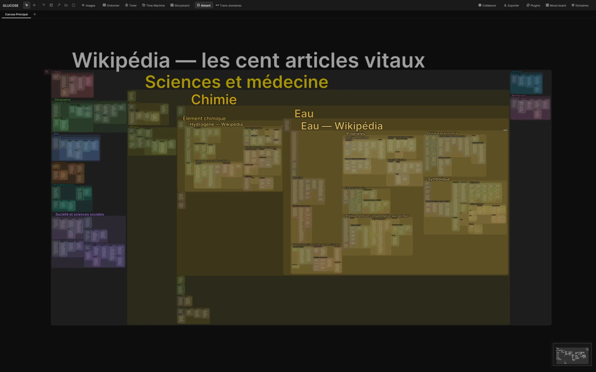

<div align="center">

# Glucose

**Un canevas infini pour penser en images et en texte.**<br>
Natif, écrit en Rust, sans navigateur.

[Télécharger](#télécharger) · [Guide](GUIDE.md) · [Discussions](https://github.com/shazamifius/GlucoseGit/discussions) · [Signaler un bug](https://github.com/shazamifius/GlucoseGit/issues/new/choose)

<br>



<sub>Les cent articles vitaux de Wikipédia, posés par un agent dans des membranes — « Eau » et « Hydrogène » en entier.</sub>

</div>

<br>

Une feuille noire, sans bord. On y pose ce qui aide à penser : des photos, des textes en Markdown,
des formules, des notes, des flèches qui disent *pourquoi* deux choses sont liées, des membranes qui
regroupent, des dossiers qui ouvrent un autre canevas. On zoome pour le détail, on dézoome pour la
forme d'ensemble.

Glucose sert à monter un moodboard, préparer du concept art, découper un storyboard, démêler un
sujet d'étude. Son horizon : rendre navigable une carte immense — jusqu'à Wikipédia entière, lisible
par un humain **et** par une IA.

L'interface est monochrome et plate. **La couleur appartient à ce que vous posez.**

> [!NOTE]
> **Glucose 2 est une bêta.** C'est Glucose réécrit en Rust ; la version 1 (Tauri) installée chez
> vous propose d'elle-même de passer à la 2, et vos documents s'y ouvrent sans être réécrits. Ce
> README décrit la branche `main` : la dernière bêta peut avoir quelques jours de retard sur lui.

## Télécharger

Sur la page [**Releases**](https://github.com/shazamifius/GlucoseGit/releases), chaque fichier est
signé, et Glucose vérifie la signature de ses mises à jour avant de les installer.

| système | fichier |
|---|---|
| Windows 10 et 11 | `Glucose_…_x64-setup.exe` — installé pour vous seul, sans droits d'administrateur |
| Linux, toute distribution | `Glucose_…_amd64.AppImage` |
| Debian, Ubuntu | `Glucose_…_amd64.deb` |
| Fedora | `Glucose-…x86_64.rpm` |
| NixOS | `nix run github:shazamifius/GlucoseGit` |
| Android | `Glucose_…_android.apk` |

Sous Windows, un avertissement peut paraître (« Windows a protégé votre ordinateur ») : Glucose
n'est pas signé par un certificat payant. « Informations complémentaires », puis « Exécuter quand
même ».

**Pas encore** : macOS (la vérification automatique le compile, aucune version n'est publiée) et
l'iPad.

## Ce qui fonctionne

Tout ce qui change le document s'annule par `Ctrl+Z`. Le détail, touche par touche : le
[guide](GUIDE.md).

| | |
|---|---|
| **Naviguer** | zoom sous le curseur, pavé tactile (pincement compris, sous Windows et Wayland), `F` cadre tout, `Alt+Z` revient d'où la vue est partie, signets de vue, minimap, onglets |
| **Chercher** | `Ctrl+F` dans tout le document, sans majuscules ni accents |
| **Le document** | enregistré à chaque geste, sans figer l'écran ; il survit à un plantage, texte en cours compris ; la Time Machine (`Ctrl+H`) remonte le temps geste par geste ; les documents de Glucose 1 s'ouvrent |
| **Images** | PNG, JPEG, WebP, GIF, BMP ; coller, glisser-déposer — depuis un navigateur aussi —, et les copier vers une autre application ; rotation, recadrage, `Ctrl+B` retire les bordures d'un lot |
| **Texte** | Markdown, tableaux, liens, formules LaTeX nettes à tout zoom |
| **Relier** | flèches droites ou courbes qui contournent ce qu'elles croisent ; six relations ; une flèche peut partir d'une phrase précise |
| **Organiser** | membranes qui emportent leur contenu, `Ctrl+G` en entoure la sélection, disposition en colonnes, dossiers, domaines qui traversent les fichiers, couleurs choisies à la roue |
| **Storyboard** | des cases qui se remplissent, la lecture, l'export en planches |
| **Exporter** | `Ctrl+E` : image PNG, Markdown ou SVG, selon le nom donné |
| **Les agents** | une IA lit et écrit le document par la même porte que vous (MCP), et chaque outil est aussi une commande du terminal : `glucose lire`, `glucose chercher eau`, `glucose poser-texte "…"` |

## Ce qui manque encore

Les presets d'interface (PureRef, Figma, Miro), les rideaux, la réglette du temps, les miroirs,
l'export HTML, les vidéos, la collaboration, les plugins et l'IA locale, Trans-domaines. Les boutons
qui ne font rien encore le disent eux-mêmes ; aucun ne fait semblant.

## Les dépendances, telles qu'elles sont

Glucose vise, à terme, **zéro dépendance** : une application que n'importe qui peut lire et forker.
Aujourd'hui, il en prend une quand il ne peut pas faire sans, et chacune se défend par écrit dans
[`docs/carnet/decisions/`](docs/carnet/decisions).

- **`glucose-core`, le noyau** — le modèle, la géométrie, le journal, le format de fichier, le
  texte : **aucune dépendance**, la bibliothèque standard seule.
- **`glucose-math`, les formules** : `katex-rs`.
- **`glucose-desktop`, l'application** : la fenêtre (`winit`), la carte graphique (`wgpu`, qui
  parle Vulkan, Metal, Direct3D et OpenGL), le dessin au processeur (`tiny-skia`, `softbuffer`),
  les lettres (`fontdue`, `ttf-parser`), les images (`image`, `png`), la signature des mises à jour
  (`minisign-verify`), les dialogues et le presse-papiers des bureaux (`rfd`, `arboard`), le réseau
  hors de Windows (`ureq`, par `rustls`), et ce que chaque système demande pour lui parler
  (`windows`, `x11rb`, `wayland-client`, `libc`).

Avec ce qu'elles tirent elles-mêmes, l'application compile **269 caisses sous Linux, 141 sous
Windows, 155 sous macOS et 162 sous Android** (9/11/2026 ; `cargo tree -p glucose-desktop -e normal
--target <système>`). Le chemin vers zéro est long ; il est mesuré, pas caché.

## Mesuré, pas affirmé

| | mesure | pour la refaire |
|---|---|---|
| **Dix millions de nœuds** | 424 Mo, chargés en 141 ms, une requête de vue en 0,21 µs *(14/09/2026)* | `cargo run --release -p glucose-core --example bench_arena` |
| **8 000 photos à l'écran**, Intel UHD 620 | un vol de caméra à 4,9 ms par image, un zoom à 9,7 ms *(7/11/2026)* | `outils/banc_hors_ecran.sh` |
| **429 photos, écran 2560 × 1600** | processeur : 4,2 à 6,3 ms, pixelisé ; carte intégrée : 1,22 ms, net ; carte dédiée : 0,26 ms, net *(21/09/2026)* | `cargo run --release -p glucose-desktop --example bench_voie_gpu` |
| **Épreuves** | un peu plus de 3 000 ; chaque garde est sabotée exprès pour vérifier que son épreuve tombe. Avant chaque publication, elles tournent sous Windows, Linux et deux Mac ; le noyau se compile pour Android et le web, l'APK et le paquet NixOS se construisent *(10/11/2026)* | `cargo test --workspace` |

## Pourquoi Rust

- **Toujours fluide** : la vue doit pouvoir bouger à la cadence de l'écran quoi qu'il se passe ;
  une action lourde se fait par tranches, sans jamais geler l'image. À l'arrêt, tout est net.
- **Aucune machine exclue** : un vieux PC, une machine sans carte graphique, un téléphone.
- **Deux moteurs, pas un compromis** : le processeur et la carte graphique ont chacun leur voie, et
  Glucose se place là où il reste de la place — pour ne jamais gêner Blender ou Photoshop ouverts
  à côté.

## Compiler soi-même

Il faut [Rust](https://rustup.rs) (stable) et un compilateur C :

```bash
git clone https://github.com/shazamifius/GlucoseGit.git
cd GlucoseGit
cargo run -p glucose-desktop --release
```

Sous Linux, rien d'autre à la compilation : Wayland, X11, Vulkan et OpenGL sont ouverts au
lancement, s'ils sont là. Les dialogues de fichiers passent par le portail du bureau
(`xdg-desktop-portal`). Sous NixOS, `nix develop` donne tout ce qu'il faut.

```
crates/
├── glucose-core/      le noyau : modèle, géométrie, journal, format de fichier, texte
├── glucose-math/      les formules LaTeX, en géométrie
├── glucose-desktop/   l'application : fenêtre, les deux voies de rendu, les systèmes, la mise à jour
└── glucose-android/   l'entrée d'Android
```

La documentation de l'ingénierie est dans [`docs/`](docs/README.md), en français.

## Glucose 1 (Tauri)

La première version (React et TypeScript dans une fenêtre Tauri) est figée sur la branche
[`tauri-v1.0.1`](https://github.com/shazamifius/GlucoseGit/tree/tauri-v1.0.1). Ses installeurs
restent dans les [Releases](https://github.com/shazamifius/GlucoseGit/releases), jusqu'à
`v1.0.2-beta.1`.

## Contribuer, soutenir

Une idée, une question : les [Discussions](https://github.com/shazamifius/GlucoseGit/discussions).
Un bug : une [issue](https://github.com/shazamifius/GlucoseGit/issues/new/choose). Pour le code :
[`CONTRIBUTING.md`](.github/CONTRIBUTING.md). Pour le faire avancer :
[GitHub Sponsors](https://github.com/sponsors/shazamifius) ou [Ko-fi](https://ko-fi.com/shazamifius).

## Licence

[MIT](LICENSE) : utilisation, modification et redistribution libres.

Le texte vu de près est dessiné par la carte graphique selon l'algorithme **Slug** d'Eric Lengyel
(brevet versé au domaine public le 17/03/2026 ; nuanceurs de référence © 2017 Eric Lengyel, licence
MIT) : sa loi est transcrite dans `crates/glucose-core/src/courbes/couverture.rs` et
`crates/glucose-desktop/src/present/formes_gpu/formes.wgsl`
([sa licence](crates/glucose-desktop/src/present/formes_gpu/LICENSE-Slug.txt)).
